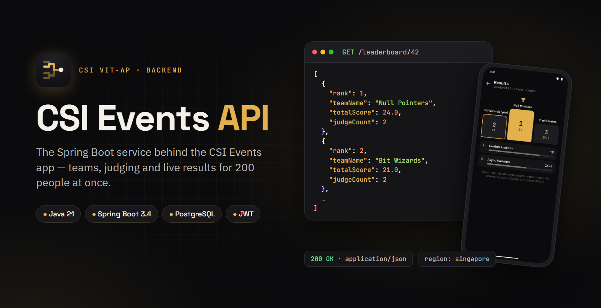
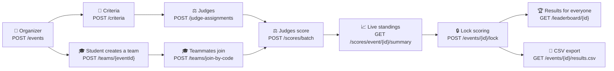
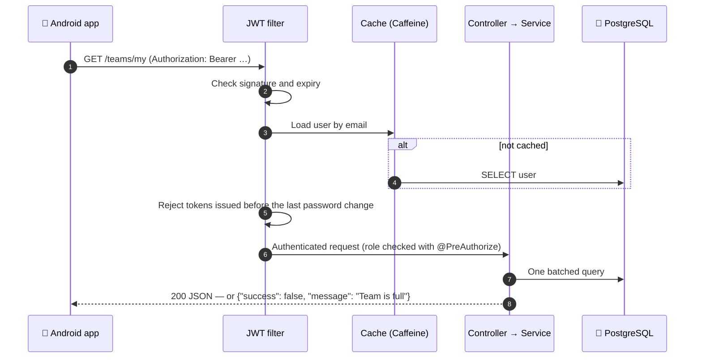
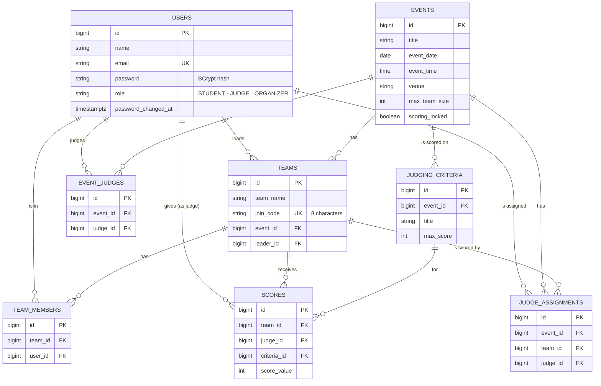
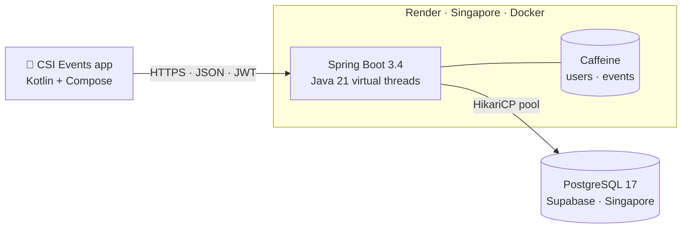

<p align="center">
  
</p>

<p align="center">
  
  
  
  
</p>

<p align="center">
  <b>The REST API that powers <a href="https://github.com/Harsh181507/CSIeventsApp">CSI Events</a>, the event app of CSI VIT-AP.</b><br>
  Events, teams with join codes, judges, scoring, live standings and results — tested with 200 people hitting it at once.
</p>

<p align="center">
  <a href="#-highlights">Highlights</a> ·
  <a href="#-the-app-it-powers">The app</a> ·
  <a href="#-how-it-works">How it works</a> ·
  <a href="#-data-model">Data model</a> ·
  <a href="#-api-reference">API</a> ·
  <a href="#-getting-started">Getting started</a> ·
  <a href="#-deployment">Deployment</a>
</p>

---

## ✨ Highlights

<table>
  <tr>
    <td width="33%" valign="top">
      <h3>🔐 Secure by default</h3>
      Stateless JWT auth with BCrypt passwords, role checks on every endpoint, college-email-only sign-up, and a lockout after 5 wrong passwords. Changing a password signs out every other device.
    </td>
    <td width="33%" valign="top">
      <h3>⚡ Built for event day</h3>
      Java 21 virtual threads, cached user lookups, batched queries and indexed foreign keys. Load-tested with 200 users opening the app at the same instant.
    </td>
    <td width="33%" valign="top">
      <h3>🧮 Race-proof</h3>
      Row locks stop a team going over its size limit, even when ten students tap <i>Join</i> together. Unique constraints stop double scores and double joins.
    </td>
  </tr>
  <tr>
    <td valign="top">
      <h3>⚖️ Fair results</h3>
      Teams are ranked by their <b>average</b> total across judges, so a team seen by three judges isn't ahead just for getting more scores. Ties share a rank.
    </td>
    <td valign="top">
      <h3>📄 Export-ready</h3>
      One endpoint returns the full results as CSV — rank, per-criterion averages, members and emails — with formula-injection protection for Excel and Sheets.
    </td>
    <td valign="top">
      <h3>📱 Play Store-ready</h3>
      Ships the privacy policy and account-deletion pages Google Play requires, plus in-app account deletion that hands team leadership on.
    </td>
  </tr>
</table>

---

## 📱 The app it powers

Every screen of the [CSI Events Android app](https://github.com/Harsh181507/CSIeventsApp) is backed by this API.

<table>
  <tr>
    <td align="center"><br><sub><b>Teams</b><br><code>/teams/**</code></sub></td>
    <td align="center"><br><sub><b>Scoring</b><br><code>POST /scores/batch</code></sub></td>
    <td align="center"><br><sub><b>Live standings</b><br><code>/scores/event/{id}/summary</code></sub></td>
    <td align="center"><br><sub><b>Results</b><br><code>GET /leaderboard/{id}</code></sub></td>
  </tr>
</table>

---

## 🧩 How it works

### The life of an event



### What happens on every request



**Roles.** Everyone signs up as a `STUDENT`. Organizers change roles with `PUT /users/role` (the app offers student ↔ judge), and the app picks up the new role on its next start. The first organizer is set directly in the database.

---

## 🗄 Data model



`SCORES` is unique on *(team, judge, criterion)* and `TEAM_MEMBERS` on *(team, user)*. A judge listed in `EVENT_JUDGES` with no `JUDGE_ASSIGNMENTS` scores every team in the event.

---

## 🏗 Architecture



The API and the database run in the same region, so every query stays inside Singapore.

| Layer | Technology |
|---|---|
| Language | Java 21 (virtual threads) |
| Framework | Spring Boot 3.4 — Web, Data JPA, Security, Validation |
| Auth | JWT (`jjwt`) + BCrypt |
| Database | PostgreSQL 17 on Supabase, Hibernate / JPA, HikariCP |
| Caching | Caffeine (in memory) |
| Build | Maven, multi-stage Docker image |
| Hosting | Render |

```
src/main/java/com/harsh/csieventmangement/
├── config/        CORS and API docs configuration
├── controller/    REST endpoints
├── dto/           request and response payloads
├── entity/        JPA entities (Event, Team, Score, User, ...)
├── exception/     ApiException + global JSON error handler
├── repository/    Spring Data repositories (batched and locking queries)
├── security/      JWT filter, user cache, login lockout, security config
├── service/       business rules
└── util/          enums
src/main/resources/static/   privacy policy and account-deletion pages
db/                          SQL scripts to run once in Supabase
```

---

## 📚 API reference

`/auth/**`, `/`, `/health` and the public pages are open. Everything else needs `Authorization: Bearer <token>`. Errors are always JSON:

```json
{ "success": false, "message": "Team is full — maximum 4 members allowed", "data": null }
```

<details open>
<summary><b>🔑 Auth</b></summary>

| Method | Endpoint | Description |
|---|---|---|
| POST | `/auth/register` | Register a new user (always `STUDENT`); email must be on an allowed domain |
| POST | `/auth/login` | Log in and receive a JWT (email is case-insensitive). 429 after 5 wrong passwords, for 15 minutes |

</details>

<details open>
<summary><b>📅 Events</b></summary>

| Method | Endpoint | Description |
|---|---|---|
| POST | `/events` | Create an event (organizer): `title`, `description`, `eventDate`, `eventTime` (`HH:mm`), `venue`, `maxTeamSize` |
| PUT | `/events/{eventId}` | Edit an event, same fields (organizer). Team size can't go below the biggest team |
| GET | `/events` | List all events, newest first |
| GET | `/events/{eventId}` | Get one event |
| GET | `/events/{eventId}/results.csv` | Full results as CSV: rank, averages per criterion, members (organizer) |
| POST | `/events/{eventId}/lock` | Lock scoring and publish results (organizer) |
| POST | `/events/{eventId}/unlock` | Reopen scoring (organizer) |
| DELETE | `/events/{eventId}` | Delete an event with its teams, criteria and scores (organizer) |
| GET | `/events/judge` | Events assigned to the logged-in judge |
| POST | `/events/{eventId}/register` | Register the current user for an event |

</details>

<details>
<summary><b>👥 Teams and members</b></summary>

| Method | Endpoint | Description |
|---|---|---|
| POST | `/teams/{eventId}?teamName=` | Create a team for an event |
| GET | `/teams/event/{eventId}` | List teams for an event |
| GET | `/teams/event/{eventId}/my` | The current student's team for an event |
| GET | `/teams/my` | All of the current student's teams, across events |
| POST | `/teams/join-by-code?code=` | Join a team using its join code |
| POST | `/teams/join/{teamId}` | Join a team by ID |
| PUT | `/teams/{teamId}/name?teamName=` | Rename a team (leader, before scoring is locked) |
| DELETE | `/teams/{teamId}/leave` | Leave a team |
| POST | `/team-members/{teamId}/add/{userId}` | Add a member (leader only) |
| DELETE | `/team-members/{teamMemberId}` | Remove a member (leader only, before scoring is locked). IDs are in a team's `memberDetails` |

</details>

<details>
<summary><b>⚖️ Judges and criteria</b></summary>

| Method | Endpoint | Description |
|---|---|---|
| POST | `/criteria` | Create a judging criterion for an event (organizer) |
| GET | `/criteria/{eventId}` | Criteria for an event |
| DELETE | `/criteria/{criteriaId}` | Delete a criterion and its scores (organizer) |
| POST | `/judge-assignments` | `{eventId, judgeId, teamIds}` — set the teams a judge scores (empty = all teams) |
| GET | `/judge-assignments/event/{eventId}` | Judges on an event and their teams |
| DELETE | `/judge-assignments/event/{eventId}/judge/{judgeId}` | Remove a judge from an event |
| POST | `/assignments/event/{eventId}/judge/{judgeId}` | Assign a judge to an event |
| POST | `/assignments/team/{teamId}/judge/{judgeId}` | Assign a judge to a team |
| GET | `/judge/events` | Events assigned to the current judge |
| GET | `/judge/events/{eventId}/teams` | Teams the current judge can score |

</details>

<details>
<summary><b>🏆 Scoring and results</b></summary>

| Method | Endpoint | Description |
|---|---|---|
| POST | `/scores/batch` | `{teamId, scores: [{criteriaId, scoreValue}]}` — save a team's scores (all or nothing) |
| POST | `/scores` | Submit a single score |
| GET | `/scores/judge?eventId=` | Scores submitted by the current judge |
| GET | `/scores/event/{eventId}/summary` | Live standings (organizer, judge) |
| GET | `/leaderboard/{eventId}` | Final top 10 for everyone, once scoring is locked |

Score = average total per judge. Tied teams share a rank (1, 1, 3, …).

</details>

<details>
<summary><b>👤 Users</b></summary>

| Method | Endpoint | Description |
|---|---|---|
| GET | `/users/me` | Current user's profile |
| PUT | `/users/me` | `{name}` — rename yourself |
| POST | `/users/me/password` | `{currentPassword, newPassword}` — returns a new token; other devices are signed out |
| POST | `/users/me/delete` | `{password}` — permanently delete your account |
| PUT | `/users/role` | Change a user's role (organizer) |
| GET | `/users/judges` | All judges (organizer) |
| GET | `/users/all` | All non-organizer users (organizer) |

</details>

<details>
<summary><b>🌐 Public</b></summary>

| Method | Endpoint | Description |
|---|---|---|
| GET | `/health` | `{"status":"UP"}` for Render and uptime monitors |
| GET | `/privacy-policy` | [Privacy policy](https://csieventmangement.onrender.com/privacy-policy) for Google Play |
| GET | `/delete-account` | [Account deletion instructions](https://csieventmangement.onrender.com/delete-account) for Google Play |

</details>

---

## 🛠 Getting started

**You'll need** Java 21+, and a PostgreSQL database (local or [Supabase](https://supabase.com)). Maven comes with the repo as `./mvnw`.

```bash
git clone https://github.com/Harsh181507/csieventmangement.git
cd csieventmangement
```

### Configuration

All secrets come from environment variables; nothing secret is committed.

| Variable | Required | Notes |
|---|---|---|
| `DB_URL` | ✅ | e.g. `jdbc:postgresql://aws-0-ap-southeast-1.pooler.supabase.com:5432/postgres` |
| `DB_USERNAME` | ✅ | `postgres.<project-ref>` on Supabase |
| `DB_PASSWORD` | ✅ | Database password |
| `JWT_SECRET` | ✅ | Random string, at least 32 characters |
| `JWT_EXPIRATION_MS` | | Token lifetime, default 7 days (`604800000`) |
| `DB_POOL_SIZE` | | Max DB connections, default `10` |
| `ALLOWED_EMAIL_DOMAINS` | | Domains allowed to sign up, comma-separated. Default `vitapstudent.ac.in`; empty allows any. Existing accounts can always log in |
| `PORT` | | Set by Render automatically |

### Run locally

Export the variables above, or create `src/main/resources/application-local.properties` (gitignored):

```properties
spring.datasource.url=jdbc:postgresql://<host>:5432/<database>
spring.datasource.username=<your-db-username>
spring.datasource.password=<your-db-password>
jwt.secret=any-local-secret-of-at-least-32-characters
```

```bash
./mvnw spring-boot:run -Dspring-boot.run.profiles=local
```

The API runs on `http://localhost:8080`. Point a debug build of the app at it with
`./gradlew installDebug -PapiUrl=http://10.0.2.2:8080/` (emulator) or your PC's LAN IP (phone).

### Run with Docker

```bash
docker build -t csieventmangement .
docker run -p 8080:8080 \
  -e DB_URL=<jdbc-url> -e DB_USERNAME=<username> -e DB_PASSWORD=<password> \
  -e JWT_SECRET=<random-32+-chars> \
  csieventmangement
```

### Tests

```bash
./mvnw test
```

The context test connects to the database, so the variables above must be set.

---

## 🚀 Deployment

1. Push the repo to GitHub.
2. In Render, choose **New → Blueprint** and pick the repo (it uses `render.yaml` and Docker). For an existing service, set **Runtime: Docker** in Settings.
3. In the service's **Environment** tab set `DB_URL`, `DB_USERNAME` and `DB_PASSWORD` (and `JWT_SECRET` if Render didn't generate one).
4. Deploy, then check that `https://<service>.onrender.com/health` returns `{"status":"UP"}`.

Keep the service in **Singapore**, the same region as the database.

### 📊 Choosing a plan (measured)

200 users opening the app at the same instant (profile, events, teams and my team), with the backend in Docker limited to each plan's CPU and 512 MB RAM:

| Plan | Startup | Typical response | Slowest 5% | Errors |
|---|---|---|---|---|
| Free (0.1 CPU) | ~150 s | ~20 s | ~40 s | some "server busy" |
| **Starter** (0.5 CPU) | ~30 s | 2–5 s | ~9 s | none |
| **Standard** (1 CPU) | ~20 s | 1–2 s | ~3 s | none |

200 *simultaneous logins* (password hashing is deliberately slow): ~25 s for the slowest 5% on Starter and ~11 s on Standard, no errors. Tokens last 7 days, so ask participants to sign in before the event.

- **Free** sleeps after 15 minutes without traffic, and the next request waits for a cold start. Fine for development, not for event day.
- **Starter** is fine for everyday use. For the event itself, switch to **Standard** for the day (billing is prorated) and back afterwards.

### Database scripts

Run these once in Supabase (**SQL Editor → New query → Run**). All are safe to re-run.

| Script | What it does |
|---|---|
| `db/001_indexes.sql` | Indexes on the foreign keys every screen filters by |
| `db/002_team_members_per_event.sql` | Checks for an old constraint that stopped students joining teams in more than one event |
| `db/003_drop_duplicate_indexes.sql` | Removes constraints and indexes that were created more than once |
| `db/004_event_time_venue_password_changed.sql` | Adds event time and venue, and the column that signs out other devices. **Run before deploying the version that uses them** |

> **Security note:** older commits of `application.properties` contained database credentials and a JWT secret for an earlier database. Retire that database or rotate its password, and never commit secrets — use the environment variables above.

---

## 🤝 Contributing

Issues and pull requests are welcome. New endpoints should follow the existing layering — `controller → service → repository` — with request and response DTOs in `dto/`, and errors thrown as `ApiException` so clients always get a readable message.

<p align="center">
  <br>
  <sub>Made for <b>CSI VIT-AP</b> · Computer Society of India, VIT-AP Student Chapter</sub>
</p>
